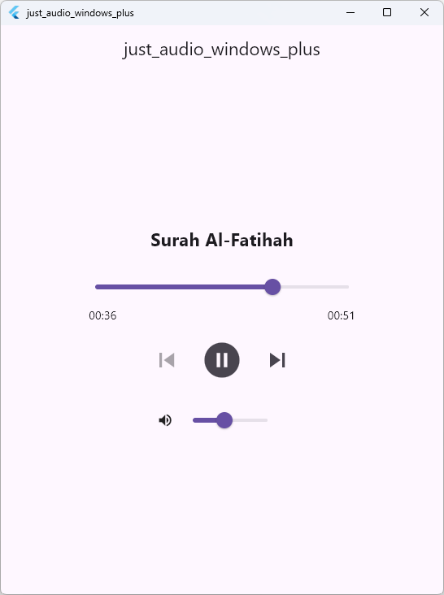

# just_audio_windows_plus — Example

Live showcase for [`just_audio_windows_plus`](https://pub.dev/packages/just_audio_windows_plus) — a hardened WinRT `MediaPlayer` engine for `just_audio` on Windows.



## Run

```powershell
flutter pub get
flutter run -d windows
```

Requirements: Windows 10/11, Flutter `>=3.47.0` for this example app (the plugin itself supports Flutter `>=3.10.0` and Dart `^3.0.0`).

## What it demonstrates

- `setAudioSources` multi-track playlist playback
- Seek scrubber, `seekToNext` / `seekToPrevious`, play/pause, and volume controls
- `playerStateStream` / `positionStream` / `durationStream` / `sequenceStateStream` wiring
- Graceful load error handling via `catchError`

> Zero native setup. `just_audio_windows_plus` is discovered automatically as the `just_audio` Windows implementation — just add `just_audio: ^0.10.6` and this package.

See the repository [README](../README.md) for the full quickstart and the production `DesktopAudioBar` widget.
