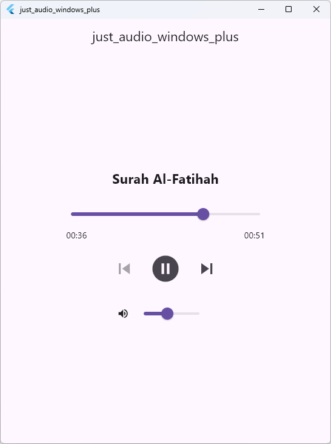

# just_audio_windows_plus — Example

Live showcase for [`just_audio_windows_plus`](https://pub.dev/packages/just_audio_windows_plus) — a hardened WinRT `MediaPlayer` engine for `just_audio` on Windows.



## Run

```powershell
flutter pub get
flutter run -d windows
```

Requirements: Windows 10/11, Flutter `>=3.10.0`.

## What it demonstrates

- `setUrl` / `setFilePath` / `setAsset` single-track playback
- `ConcatenatingAudioSource` playlists with `LoopMode` and shuffle
- `seek`, `seekToNext` / `seekToPrevious`, volume & speed
- `playerStateStream` / `positionStream` / `durationStream` wiring
- Error handling via `PlayerException` on 404 / missing files

> Zero native setup. `just_audio_windows_plus` is discovered automatically as the `just_audio` Windows implementation — just add `just_audio: ^0.10.6` and this package.

See the repository [README](../README.md) for the full quickstart and the production `DesktopAudioBar` widget.
